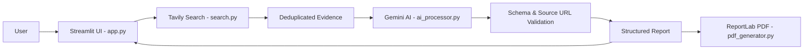

# Company Research Agent

A professional, evidence-grounded company research application built with Python and Streamlit. Enter a company name to retrieve public web evidence with Tavily, synthesize a structured report with Google Gemini, review cited sources, and download a ReportLab PDF.

> The application does not fabricate facts or create guessed contact details. Missing information is shown as **“Not publicly available”**.

## Features

- Targeted searches for overview, employee size, locations, news, leadership, and public professional contacts
- Deduplicated, validated URLs from credible public sources
- Gemini JSON generation constrained to supplied Tavily evidence
- URL allowlist validation to flag unsupported citations
- Responsive Streamlit dashboard with six report tabs
- Professional PDF export with clickable links and page numbers
- API and missing-result error handling

## Technology Stack

- Python 3.11+
- Streamlit
- Tavily Search API
- Google Gemini via `google-genai`
- python-dotenv
- ReportLab
- pytest

## Architecture



## Folder Structure

```text
company-research-agent/
├── app.py
├── search.py
├── ai_processor.py
├── pdf_generator.py
├── requirements.txt
├── .env.example
├── .gitignore
├── README.md
└── tests/
    └── test_app_logic.py
```

## Local Installation

Windows PowerShell:

```powershell
cd company-research-agent
py -m venv .venv
.\.venv\Scripts\Activate.ps1
python -m pip install --upgrade pip
pip install -r requirements.txt
Copy-Item .env.example .env
```

Open `.env` and replace placeholders:

```env
TAVILY_API_KEY=your-tavily-key
GEMINI_API_KEY=your-gemini-key
```

Run:

```powershell
streamlit run app.py
```

Open the URL shown by Streamlit (normally `http://localhost:8501`).

## API Configuration

### Tavily

Create a Tavily account and API key, then set `TAVILY_API_KEY`.

### Google Gemini

Create a Google AI Studio API key, then set `GEMINI_API_KEY`. The default model is `gemini-2.5-flash` and can be changed in `ai_processor.py`.

For Streamlit Community Cloud, add secrets in **App > Settings > Secrets**:

```toml
TAVILY_API_KEY = "tvly-your-key"
GEMINI_API_KEY = "your-gemini-key"
```

Do not commit `.env`, keys, or generated PDFs.

## Tests

```powershell
pytest -q
```

Tests cover URL validation, deduplication, JSON parsing, missing values, and removal of unsupported citations.

## Usage Example

1. Enter a company such as `Microsoft Corporation`.
2. Select **Research Company**.
3. Review each tab.
4. Open source links and verify important details.
5. Download the PDF report.

Avoid extremely generic names such as `Tech Company`; add a country or legal name for better results.

## Deploy to Streamlit Community Cloud

1. Push the project to GitHub.
2. Visit Streamlit Community Cloud and select **Create app**.
3. Connect the GitHub repository.
4. Set the main file to `app.py`.
5. Add `TAVILY_API_KEY` and `GEMINI_API_KEY` under app secrets.
6. Deploy.

## GitHub Upload

```powershell
cd company-research-agent
git init
git branch -M main
git add .
git commit -m "Initial commit: Company Research Agent"
git remote add origin https://github.com/YOUR_USERNAME/company-research-agent.git
git push -u origin main
```

## Limitations

- Search quality depends on public indexing and the Tavily plan.
- Some private or newly changed company facts may be unavailable.
- Gemini may summarize snippets imperfectly; all important facts should be independently checked.
- Public contact details may be general departmental addresses rather than executive personal data.
- Search and AI use is subject to API quotas, rate limits, and provider policies.

## Future Improvements

- Source credibility ranking
- Regional and language search support
- Saved research history
- Company comparison reports
- Automated link health checks
- Optional human verification workflow
